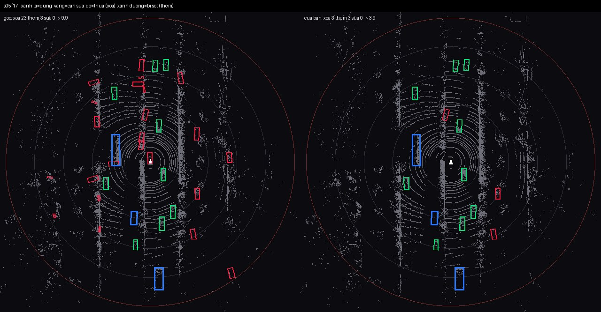

# Báo cáo Day 14 — Bùi Công Đạt — 2A202603068

- Mã học viên dùng cho `--student`: `068`
- `seed_tag` trong `frames_A.txt`: `5a7fa52eb3`

## 1. Dự đoán trước sweep (bước 5b)

- Tham số tôi nghĩ giảm công sửa nhiều nhất: `score_thr` (tăng từ 0.1 lên 0.5).
- Vì sao: ảnh BEV tập A cho thấy box thừa khá nhiều quanh các cụm điểm nhiễu, trong khi box sót ít hơn. Tăng ngưỡng tin cậy sẽ bỏ bớt box thừa; `min_points` tôi đoán ít tác dụng vì box thừa vẫn có đủ điểm.

## 2. Tập A: sửa tay và tune

| Cấu hình | Xóa | Thêm | Sửa | Chi phí |
|---|---:|---:|---:|---:|
| Gốc | 51 | 7 | 1 | 22.8 |
| `best_config.json` | 11 | 12 | 0 | 15.3 |

- Tham số đã đổi trong `best_config.json`: `score_thr: 0.1 → 0.5` (các tham số khác giữ nguyên).
- Kết quả leave-one-out (chọn trên 2 frame còn lại, chấm trên frame bỏ ra):
  - `s02f15`: cấu hình chọn `score_thr=0.5, min_points=0` → 7.1 (tốt nhất có thể 7.1)
  - `s04f50`: cấu hình chọn `score_thr=0.5, min_points=0` → 4.3 (tốt nhất có thể 3.6)
  - `s05f17`: cấu hình chọn `score_thr=0.5, min_points=0` → 3.9 (tốt nhất có thể 3.9)
- Cấu hình có ổn định trên từng frame không? Có: cả 3 lượt leave-one-out đều chọn `score_thr=0.5`, và 2/3 frame đạt đúng mức tốt nhất có thể. Tôi vẫn chọn cấu hình này vì nó giảm mạnh box thừa (51 → 11) dù có tăng box sót (7 → 12); tổng chi phí giảm 33%. Chỉ 3 frame tune nên kết quả còn yếu, không nên tin tuyệt đối.

## 3. Trước/sau (bước 8)

- `scripts/pp_compare.py` báo giảm 33% công sửa trên tập A (22.8 → 15.3).
- Dự đoán ở mục 1 đúng: tăng `score_thr` làm giảm box thừa rõ rệt (xóa 51 → 11). Nhưng đổi lại box sót tăng (thêm 7 → 12), nên mức giảm thực tế thấp hơn kỳ vọng ban đầu. Đúng hướng, chưa đúng mức.

## 4. Tập B

Số đo từ `scripts/pp_prelabel.py --frames d14_068/frames_B.txt --config d14_068/best_config.json --gt d14_068/ref_B.json`:

| Xóa | Thêm | Sửa | Chi phí |
|---:|---:|---:|---:|
| 35 | 15 | 8 | 29.5 |

Tổng: GT 140 box, dự đoán 160 box, khớp 125 box trên 12 frame.

- Loại box tốn công sửa nhất ở tập B: box thừa (xóa 35 box, chiếm 10.5/29.5 chi phí) và box bị sót (thêm 15 box, chiếm 15/29.5). Box cần sửa chỉ 8. Nhiều khả năng là Cyclist/Pedestrian bị sót và box thừa quanh cụm điểm nhiễu, vì model học trên KITTI không có Truck/Bus.

## 5. Giới hạn

- Chỉ tune trên 3 frame tập A, rất ít; cấu hình có thể overfit và không ổn định trên tập B.
- Model học trên KITTI (LiDAR 64 tia, chỉ 3 lớp Car/Cyclist/Pedestrian), không có Truck/Bus; trên VF thường sót Pedestrian/Cyclist.
- Chi phí `0.3·xóa + 1.0·thêm + 0.5·sửa` là công thức của đề, chưa đo bằng thời gian sửa thật.
- Chỉ chấm box có tâm trong 50 m; box ngoài phạm vi không được tính.
